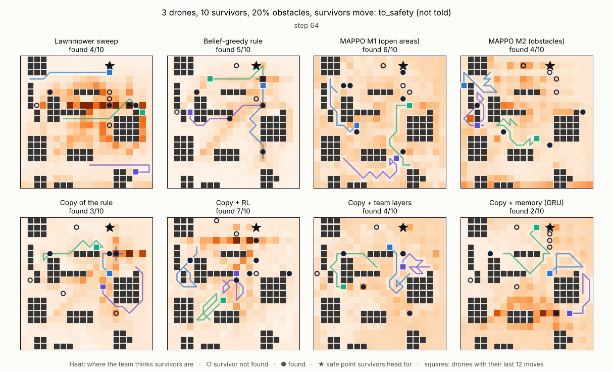
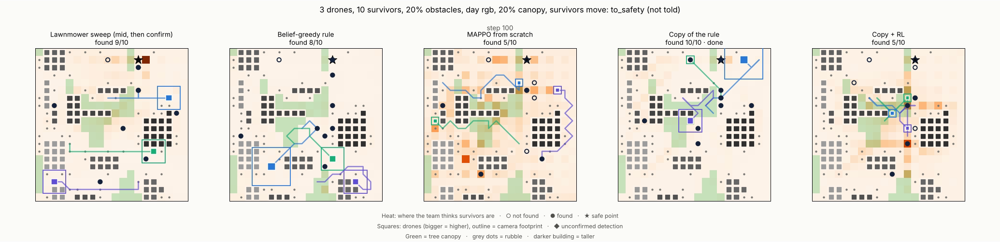
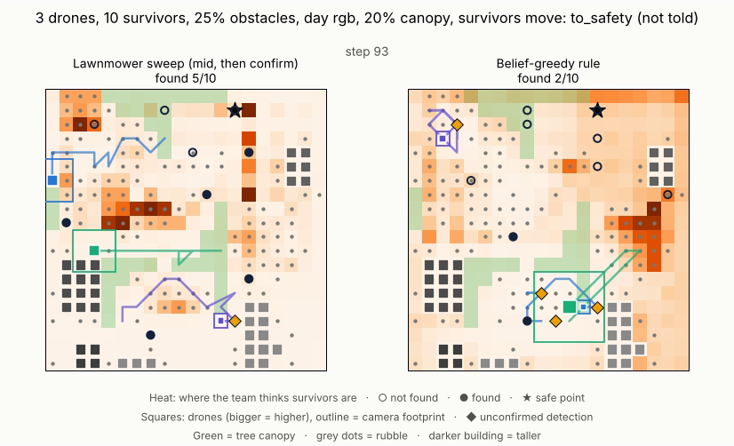

# Learning to Search: Cooperative Drone Swarms from Grid Worlds to Field-Realistic Missions

Hassan Edwan · MSML642 · November 2026

## Abstract

We study cooperative search for missing people with a swarm of drones that
shares a probabilistic map of where people may be and is controlled by a
single policy trained with multi-agent proximal policy optimisation (MAPPO).
The environment was developed in stages, each adding a feature of the real
problem once the previous stage's goal was met: moving survivors and online
inference of how they move, obstacles, quadrotor flight in 3D, a camera with
flying height, occlusion and false alarms, and finally a field environment
with real terrain, lost-person statistics, operator review of detections,
battery logistics and radio limits. The shared map gives up to a 2× speed-up
over a lawnmower sweep, and the learned policy matches, but does not exceed, a
hand-written greedy rule that uses the same map. We show that this ceiling is
largely an artefact of simulators that give the rule a correct model of the
world: once the sensor, map and people disagree with the drones' model, the
rule degrades below a plain sweep. A field environment built to an explicit
register of assumptions makes realistic wilderness search hard for both
baselines (about a quarter of missions succeed), and sets up the problem for
large-scale training.

## 1 Introduction

Drones are now routine in search and rescue, but deciding where a team of
drones should look, as evidence accumulates, is still done by hand or by
fixed patterns. Search theory gives the right object, a probability map
updated by Bayes' rule as areas are searched [1, 2], and lost-person research
gives the priors [3]. Reinforcement learning offers a way to turn such a map
into coordinated moves for many drones.

This project asked whether a learned multi-agent policy can search faster than
fixed strategies, and then progressively asked the question in harder and more
realistic settings. Each stage was kept as simple as possible until its goal
was met. When the learned policy reached the level of a strong rule but not
beyond, we examined what the simulator assumed, found that it favoured the
rule, replaced those assumptions with ones grounded in search-and-rescue
research, and built an environment realistic enough to be the target of
future large-scale training. Section 2 describes how the environment evolved,
Section 3 the methods, Section 4 the results at each stage, and Section 5 what
they mean.

## 2 Environment

The environment evolved in eight stages (Table 1). All share the same
interface: each drone picks a move every step, a shared map of where people
may be is updated from what the drones see, and the mission is scored by how
quickly people are found.

**Table 1.** Stages of the environment.

| Stage | Added | World |
|---|---|---|
| M1 | Moving survivors, inference of their movement, safety shield | 20 × 20 grid of 10 m cells; 2–8 drones; 1–20 survivors still, wandering, drifting or walking to a safe point |
| M2 | Obstacles | 0–30% of cells blocked |
| M3–M4 | 3D flight | Crazyflie quadrotors in PyBullet [7] under PID control, wind gusts, buildings taller than the drones |
| M5 | Evaluation | Find-time metric, hand-written baseline, larger grids and teams |
| M6 | Camera | Three flying heights with wider but weaker views, line of sight past buildings, rubble and canopy, false alarms confirmed by a low pass, day/dusk/thermal sensors |
| M7 | Model mismatch | True detection 0.4–1.1× the modelled one, unseen collapses, radio-limited map sharing, wind and GPS error, per-person behaviour |
| — | Assumptions register | 46 assumptions checked against 22 sources (`docs/ASSUMPTIONS.md`) |
| M8 | Field environment | Urban, wilderness and flood families; real terrain or imported map data; ISRID lost-person statistics [3–5]; operator review; batteries and swaps; terrain-limited radio; ground teams |

M1–M5 grew the problem only as far as needed to test each claim. M6 replaced
the idealised camera. M7 and the register removed assumptions under which the
drones' model of the world was always correct. M8 rebuilt the environment
around evidence: the wilderness search area is sized to the subject
category's 75% distance in ISRID (3.8 km across for dementia, 11.6 km for a
hiker) [3–5]; people may not respond to searchers or may hide [3, 6];
detections are reviewed by an operator before they count; looks from the same
direction are correlated [10]; and a mission lasts 90 minutes with battery
swaps. Every number in M8 is labelled as published, fitted or assumed.

## 3 Methods

**Shared map.** The team keeps, for each cell, the expected share of
undetected people there. A look lowers a cell by the modelled detection
probability; each step the map is propagated with a movement model. When the
movement is unknown, the map is a mixture over movement hypotheses whose
weights are updated by Bayes' rule from searches and finds [1, 2]. In M8 the
map also tracks the probability that the person has left the area, and the
reduction from repeated looks depends on the viewing direction.

**Policy.** A shared actor and a centralised critic trained with MAPPO [8];
each drone observes local windows of the map, a coarse summary, its teammates
and mission state, so the policy is independent of map size and team size.
The reward is the probability mass a drone's search clears plus a bonus per
find; from M6 on, the find bonus is proportional to how early the find
happens, so total reward equals the evaluation metric.

**Baselines.** A lawnmower sweep, and a *belief-greedy rule* that sends each
drone to the most valuable cell (or, with a camera, cell and height) per unit
of travel on the same map, avoiding teammates' targets. We also trained
copies of the rule by behaviour cloning and DAgger [9], and fine-tuned them
with RL.

**Metric.** Mean time to find a person, with anyone not found counted as the
mission length; M8 also reports rescue time and the share found.

## 4 Results

**Grid search (M1–M2).** With predictable movement the map-based policy finds
survivors in about half the sweep's time (Table 2, Figure 1). With still or
randomly wandering survivors and no prior, all methods tie: the problem is
pure coverage. Inferring movement online recovers part of the gap when the
team is not told how people move.

**Table 2.** Mean time to find a survivor, % of the mission (lower is better;
100 missions; ±1).

| Condition | MAPPO | Rule | Sweep |
|---|---|---|---|
| Still | 48 | 48 | 48 |
| Walking to safety, target told | 27 | 26 | 56 |
| Walking to safety, not told | 45 | 44 | 56 |
| Likely zones | 36 | 34 | 53 |
| Random mix with obstacles | 32 | 30 | 42 |

**Figure 1.** Grid world with obstacles: one mission flown by eight methods;
heat is the team's map. [Video](../results/figures/all_models.mp4).

**Flight (M3–M4).** Flown by quadrotors in PyBullet, the 3D missions reproduce
the 2D results in calm air and hold up to about 2 m/s² gusts (Figure 2), so
search and flight can be developed separately.

**Figure 2.** The same kind of mission flown in 3D. [Video](../results/figures/flight_3d.mp4).

**The learning ceiling (M5).** The learned policy matched the rule within
noise on every condition. Run-time lookahead, imitation followed by RL,
teammate trails and headings, and a recurrent actor all reached the same
level; copies of the rule disagreed with it on 45% of moves yet performed the
same, indicating many near-equivalent choices. The bottleneck was the
information in the map, not the policy.

**Camera (M6).** Camera geometry exposed reward design problems. The first RL
policy covered 95% of the ground and found no one by hovering high to collect
the clearing reward; after capping that reward, the from-scratch policy
earned more training reward than the rule while being slower. A copy of the
rule matched the rule (random mix: 49 vs 51 steps, 78% found); RL from
scratch and RL fine-tuning reached 58–63 steps. A reward equal to the
find-time metric removed the misalignment; the remaining gap traces to RL
learning from sampled rather than greedy actions, and a run from a sharpened
copy is in progress (Figure 3).

**Figure 3.** Camera world: drones choose a height (larger squares fly higher;
outlines are footprints) and confirm candidate detections (diamonds).
[Video](../results/figures/camera_models.mp4).

**Model mismatch (M7).** Until M6 the drones' model of the world was exact.
Introducing gaps one at a time (Table 3) shows the rule's dependence on its
model: with a sensor weaker than assumed it marks unsearched areas as
cleared and never returns, falling behind the sweep; with all gaps together
the sweep is faster (Figure 4).

**Table 3.** Find time (steps of 100) / share found; 12 missions each.

| Gap | Sweep | Rule |
|---|---|---|
| None | 56 / 82% | 49 / 88% |
| Weaker sensor than modelled | 72 / 59% | 74 / 52% |
| All five gaps | 76 / 45% | 79 / 42% |

**Figure 4.** Model mismatch: sweep and rule on the same mission with every
gap switched on. [Video](../results/figures/real_gaps.mp4).

**Field environment (M8).** In the wilderness family, one person may be
anywhere in up to 135 km² of forest. In a sample of 12 missions the rule and
the sweep each found the person in 3; a typical success (Figure 5a) takes
two rounds of battery swaps, during which the rule sends every drone home at
once, and a ground team reaches the person half an hour after the find. The
urban family (Figure 5b) is dominated by trapped people in unseen collapses
and by operator load (about 100 detections per 30 minutes, most false); in
the flood family (Figure 5c), held out of training, people drift with rising
water and many leave the area before they are found. The evaluation on all
twelve field conditions, including eight hard cases (unresponsive and
evasive people, a wrong last-seen point, a person outside the area, a weak
sensor, a late start, radio dead zones, unmodelled behaviour), is pending.

**Figure 5.** Field environment, belief-greedy rule. (a) Wilderness: a hiker
on an 11.6 km map sized from ISRID data. [Video](../results/figures/field_wilderness.mp4).
(b) Urban collapse with smoke. [Video](../results/figures/field_urban.mp4).
(c) Flood with rising water. [Video](../results/figures/field_flood.mp4).

## 5 Discussion

Three observations hold across the stages. First, the information a team
holds matters more than how it acts on it: a shared probability map accounts
for most of the gain over a sweep, and learning on top of a correct map
reaches but does not pass a well-designed rule. Second, the strength of a
hand-written rule is conditional on its model; when the world departs from
the model, as it does in every real search, the rule has no mechanism to
notice and can fall below a model-free sweep. This is the regime in which a
learned policy that conditions on evidence, such as finds against
expectations or time out of radio contact, has room to improve. Third, each
step towards realism changed the conclusions: camera geometry revealed reward
misspecification, model mismatch reversed the ranking of the baselines, and
real lost-person data tripled the size of the search area.

**Limitations.** Some field parameters are fitted or assumed rather than
published (hunter and despondent distances, detection and operator rates);
each is marked in the register with the field measurement that would
calibrate it. All training ran on four CPU cores with one seed per model.

## 6 Conclusion and Future Work

Starting from a grid world, we extended the problem until a learned swarm
matched a strong rule, identified the simulator assumptions that made the
rule hard to beat, replaced them with evidence-based models, and built a
field environment in which realistic search is hard for both baselines. The
next step is training at scale in that environment: imitation of the rule
followed by RL with the find-time reward across the urban and wilderness
families, evaluated on the hard cases and on the held-out flood family, with
several seeds. That requires substantially more compute than was available
here. Field calibration of detection, operator and radio parameters at a test
site, and a learned flight controller behind the same waypoint interface,
follow.

## References

1. B. O. Koopman. *Search and Screening: General Principles with Historical Applications.* Pergamon, 1980.
2. L. D. Stone. *Theory of Optimal Search.* Academic Press, 1975.
3. R. J. Koester. *Lost Person Behavior: A Search and Rescue Guide on Where to Look.* dbS Productions, 2008.
4. R. J. Koester et al. Autism spectrum disorder and typically developing children: lost person behavior (ISRID). *Journal of Search & Rescue* 4(1), 2020.
5. A pragmatic approach to applied search theory. *Journal of Search & Rescue* 4(1), 2020.
6. M. A. Goodrich et al. Supporting wilderness search and rescue using a camera-equipped mini UAV. *Journal of Field Robotics* 25, 2008.
7. J. Panerati et al. Learning to fly: a Gym environment with PyBullet physics for reinforcement learning of multi-agent quadcopter control. *IROS*, 2021.
8. C. Yu et al. The surprising effectiveness of PPO in cooperative multi-agent games. *NeurIPS Datasets and Benchmarks*, 2022.
9. S. Ross, G. Gordon, J. A. Bagnell. A reduction of imitation learning and structured prediction to no-regret online learning. *AISTATS*, 2011.
10. D. C. Schedl, I. Kurmi, O. Bimber. An autonomous drone for search and rescue in forests using airborne optical sectioning. *Science Robotics* 6(55), 2021.
11. L. Lin, M. A. Goodrich. A Bayesian approach to modeling lost person behaviors based on terrain features in wilderness search and rescue. *Computational and Mathematical Organization Theory* 16(3), 2010.
12. M. Jacobs. Terrain based probability models for SAR. Mountain Rescue Association, 2016.

Reproduction commands, the full result tables and the assumptions register are in the repository (`README.md`, `results/`, `docs/ASSUMPTIONS.md`).
