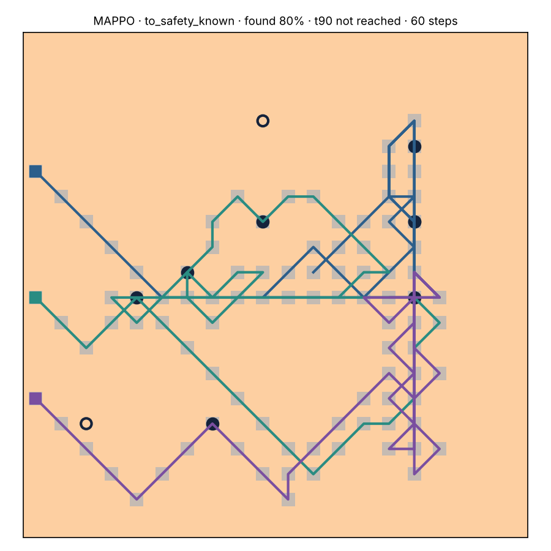
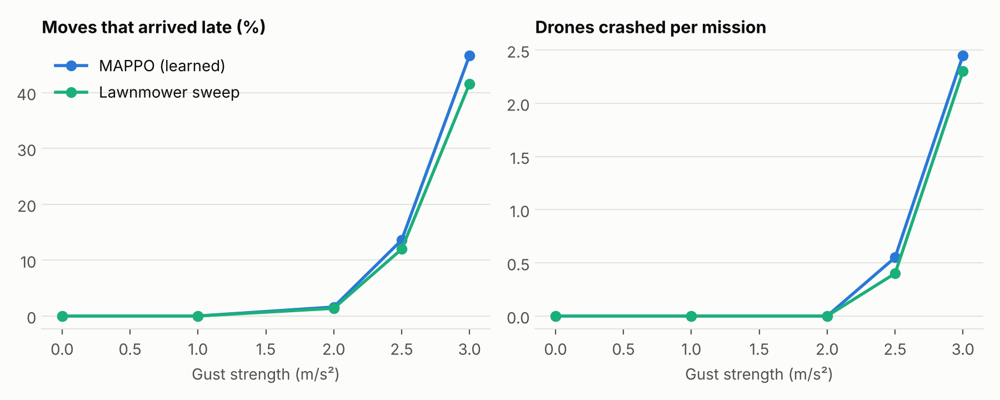
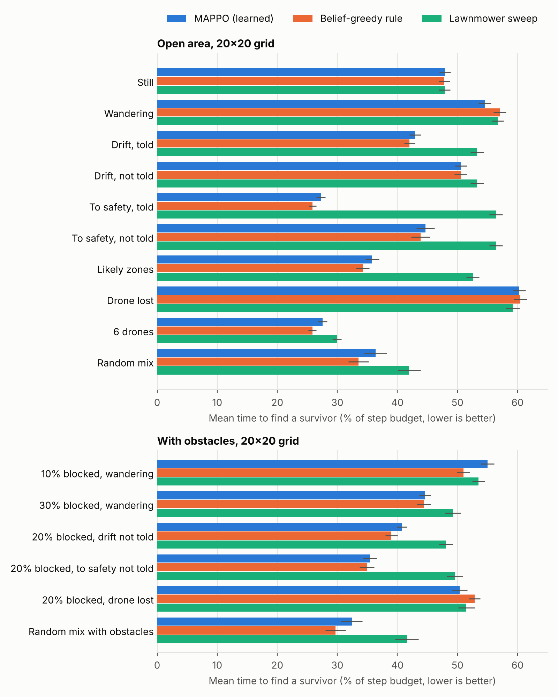
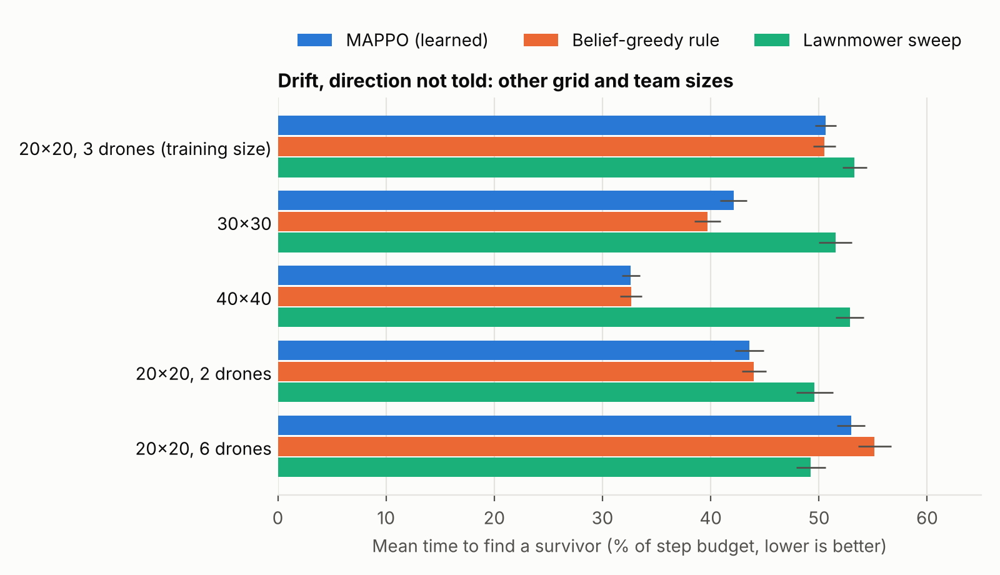

# Cooperative Drone Swarm Search: From a Grid World to the Field

MSML642 project, Hassan Edwan. A team of drones searches for people after a
disaster or for someone lost in the wilderness. One shared policy, trained
with multi-agent reinforcement learning (MAPPO), picks every drone's next
move. This report follows the project from its first, simplest version to
the current one, and shows how each stage made the problem and the
environment more like the real thing, what each stage taught us, and why it
led to the next. Setup and usage are in the [README](../README.md); what the
simulator assumes, and the evidence for it, is in the
[assumptions register](ASSUMPTIONS.md).

## 1. Summary

The project went through eight stages. Each one removed a simplification:

| Stage | What the world gained | What we learned |
|---|---|---|
| **M1** Grid search | 2D grid, 2–8 drones, survivors that stay, wander, drift or walk to safety; a shared probability map; online inference of how survivors move | The map, not the learning, is what makes search fast: up to 2× faster than a lawnmower sweep when survivors move predictably |
| **M2** Obstacles | Buildings and rubble on 0–30% of the map | The same gains hold with obstacles |
| **M3–M4** 3D flight | Quadrotors flown in PyBullet by PID, wind gusts, tall buildings | The policy flies: 3D matches 2D in calm air and holds up to ~2 m/s² gusts |
| **M5** Generality | A find-time metric, a strong hand-written rule on the same map, bigger maps and teams | The learned policy matches the rule but does not beat it; lookahead, imitation, team awareness and memory all hit the same ceiling. The ceiling is information, not learning |
| **M6** Camera | Flying height, footprints, line of sight, cover, false alarms, light | Rewards must match the goal: RL first learned to hover high and find no one, then to search slowly low down; only a copy of the rule reaches the rule |
| **M7** Real-world gaps | The world disagrees with the drones' model: weaker sensors, unknown collapses, radio limits, wind and GPS error, people who follow no pattern | The rule is fragile: with every gap at once it is slower than a plain sweep. This is where learning should help |
| **Register** | A list of every assumption, with evidence from lost-person research and field trials | Most assumptions about the person were optimistic: many people do not respond to searchers, some hide, phones rarely help |
| **M8** Field | Three scenario families (urban collapse, wilderness, flood) built to the register: real terrain, ISRID lost-person data, people who react or hide, an operator who reviews every detection, batteries and swaps, radio over terrain, ground teams | A realistic wilderness search is hard: one hiker in up to 135 km² with 2–4 drones in 90 minutes. Both baselines find the person in about a quarter of missions |

Three findings run through every stage:

1. **What the drones know matters more than how they decide.** A shared,
   up-to-date probability map gives most of the gain. Learning matches a good
   rule on that map and cannot pass it while the map is right (M1–M5).
2. **A hand-written rule is only as good as its model of the world.** When the
   simulator gives the rule exactly what it assumes, it is near-optimal. When
   the world disagrees with it (M7, M8), it degrades, sometimes below a sweep.
   That gap is where a learned, adaptive policy has room to win.
3. **Each step towards realism changed the answer.** Camera geometry exposed
   reward design problems; real-world gaps reversed the ranking of the
   baselines; real lost-person data changed the size of the search area by
   a factor of three.

## 2. M1: the grid search problem

**The world.** A 20×20 grid of 10 m cells (200 m square), one step ≈ 1 s.
2–8 drones, each moving to one of 8 neighbours or hovering; one may fail
mid-mission. 1–20 survivors who stay put, wander, drift one way (flood
water) or walk to a safe point at 0.3–1.5 m/s. In 40% of missions there are
likely zones (50–100% accurate). The camera finds a survivor in the cell
below with probability 0.6–1.0 per pass. A safety shield resolves
conflicting moves so drones never collide.

**The shared probability map.** The team keeps the expected number of
undetected survivors in each cell. Searching a cell lowers it by the
detection chance; each step the map moves the way survivors move. When
nobody tells the team how survivors move, it tracks 116 movement hypotheses
and reweights them after every search, so it works out during the search
whether people are still, drifting or heading somewhere.

**The policy.** MAPPO: one shared actor, a centralised critic that sees the
whole state in training only, 2M steps per model on 4 CPU cores. Each drone
sees 5×5 windows of the map, a coarse summary, its teammates and the
inferred movement (167 values, independent of grid size).

**What we tried along the way.** IPPO (no centralised critic) learned about
as well as MAPPO; a full-map CNN actor and a transformer actor were built but
not needed; an LLM planner that picked regions for the drones was tried and
dropped in favour of the map. Survivors that move, and inferring how they
move, turned out to be the core of the problem.

**Result.** With predictable movement the map-based policy is far ahead of a
lawnmower sweep; with still or randomly wandering survivors and no likely
zones, nothing beats a sweep (it is pure coverage). Full numbers in §6.



*MAPPO on "survivors walk to a known safe point": the drones converge on where
survivors are heading instead of sweeping.*

## 3. M2: obstacles

Blocks of 1–4 cells (buildings, rubble, water) on up to 30% of the map.
Survivors route around them, and the map's movement model does too. The M2
model is fine-tuned from M1. The gains carry over: with 20% blocked and
survivors walking to an untold safe point, find time is 35% of the budget
against the sweep's 50%.

## 4. M3–M4: flying it in 3D

Each policy step is flown by Crazyflie quadrotors in PyBullet with a PID
controller, one height layer per drone; a drone that has not reached its
cell in time does not search that step. M4 adds buildings taller than the
drones, with no diagonal moves past corners.

- In calm air the 3D missions reproduce the 2D results exactly (tracking
  error about 1 cm), with no building hits.
- Up to 2 m/s² gusts, fewer than 2% of moves arrive late; at 3 m/s² flight
  breaks down. The limit is the controller, not the search.



**What it showed:** the search layer and the flight layer can be built
separately. The policy chooses "go to this cell", and a controller flies it,
so a learned flight controller can later replace PID behind the same
interface.

## 5. M5: does learning add anything?

To judge the learned policy fairly, M5 added a sharper metric (mean time to
find a survivor, with anyone not found counted as the whole budget) and a
strong hand-written baseline: the **belief-greedy rule**, which sends each
drone to the most valuable cell on the same map per unit of travel, avoiding
teammates' targets.

**The policy matched the rule but did not beat it.** Four ideas were tested,
each aimed at one possible cause:

| Idea | Hypothesis | Result |
|---|---|---|
| Run-time lookahead | The policy is close but noisy | 0–7 steps better; within noise |
| Imitate the rule, then RL | RL from scratch lands in a worse optimum | RL improved the copy to the same level, not past the rule |
| Team layers (all teammates' trails and headings) | Drones lack teammate information | No change |
| Memory (GRU) | The rule keeps a target across steps | A small gain |

**What it showed:** every route converges to the same level. The bottleneck
was what the drones could know, not how the policy was trained, which
pointed the project at the world instead of the algorithm.

The policy did generalise without retraining: 20–38% faster than the sweep on
30×30 and 40×40 grids, and ahead of the rule on the hardest condition tested
(40×40, destination unknown; suggestive, ±25 steps).

## 6. Results of the grid stages (M1–M5)

Mean time to find a survivor, as a share of the mission budget (lower is
better); 100 missions per condition, ±1 point.



| Condition | MAPPO | Belief-greedy | Lawnmower |
|---|---|---|---|
| Still | 48% | 48% | 48% |
| Wandering | 55% | 57% | 57% |
| Drift, told | 43% | 42% | 53% |
| Drift, not told | 51% | 51% | 53% |
| To safety, told | 27% | 26% | 56% |
| To safety, not told | 45% | 44% | 56% |
| Likely zones | 36% | 34% | 53% |
| Drone lost | 60% | 60% | 59% |
| 6 drones | 28% | 26% | 30% |
| Random mix | 36% | 34% | 42% |
| 20% blocked, drift not told | 41% | 39% | 48% |
| 20% blocked, to safety not told | 35% | 35% | 50% |
| 30% blocked, wandering | 45% | 44% | 49% |
| Random mix with obstacles | 32% | 30% | 42% |



Video of one mission flown by eight methods:
[`results/figures/all_models.mp4`](../results/figures/all_models.mp4); the same
kind of mission flown in 3D: [`results/figures/flight_3d.mp4`](../results/figures/flight_3d.mp4).


## 7. M6: a real camera

The grid stages assumed a camera that sees exactly the cell below with a
fixed chance. M6 replaced it with five effects a real search drone faces:

| Effect | Model |
|---|---|
| Flying height | Climb and descend actions. Low (15 m) sees 1 cell, mid 3×3, high 5×5; detection falls with height and off-centre |
| Line of sight | Buildings 10–50 m tall hide what is behind them |
| Cover | Rubble and tree canopy lower detection |
| False alarms | From mid or high, a detection is only a candidate; a low pass confirms it |
| Light and sensor | Day, dusk, night thermal, midday thermal |

**Lesson 1, reward hacking.** The first RL run reached 95% coverage and found
nobody: drones stayed high and collected the reward for clearing empty ground
over the wide footprint, never coming down to confirm.

**Lesson 2, the reward must be the goal.** After capping the high-altitude
reward, three policies were trained (100 missions per condition; find time
in steps of 100 / share found):

| Condition | Sweep | Rule | From scratch | Copy of the rule | Copy + RL |
|---|---|---|---|---|---|
| Open ground | 48 / 88% | 46 / 87% | 75 / 45% | **44 / 88%** | 74 / 45% |
| City, survivors head to safety | 54 / 80% | 47 / 87% | 64 / 67% | **46 / 84%** | 65 / 64% |
| Night, thermal | 58 / 77% | 51 / 84% | 66 / 66% | **50 / 81%** | 68 / 62% |
| Random mix | 55 / 71% | 51 / 78% | 58 / 65% | **49 / 78%** | 63 / 57% |

Only the copy of the rule reached the rule. Scoring every policy under the
training reward showed why RL drifted away: the slower from-scratch policy
earned *more* reward than the rule (127 vs 108), by farming the reward for
low passes. The training reward and the goal disagreed.

**Fix: a find-time reward.** Each find now pays 20 × (1 − time / mission
length), so the total reward is exactly the find-time metric. Offline, the
rule now scores highest, as it should. The fine-tune kept the rule's routine
(94–98% coverage instead of 68%) but stayed slower than the copy (random mix
57 / 68% vs 49 / 78%). This time the training was at fault: the copy is good
only when it takes its top action, and RL learns from sampled actions. A run
starting from a sharpened copy, with no exploration bonus, is in progress.


*Video: [`results/figures/camera_models.mp4`](../results/figures/camera_models.mp4).*

## 8. M7: when the world disagrees with the drones' model

Every earlier stage gave the drones a correct model of the world. M7 broke
that, one effect at a time (all optional, built on the camera world):

| Gap | What changes |
|---|---|
| Sensor | True detection 0.4–1.1× what the map assumes; people differ in visibility; false alarms 0.5–3× |
| Map | Buildings have collapsed into rubble that holds trapped people; unknown until seen |
| Radio | Each connected group shares a map; groups merge maps when they meet |
| Position | Wind pushes drones off their cell; GPS is sometimes a cell off |
| People | Each person behaves differently; the operator's hint covers only the main behaviour |

First check (12 missions each; mean find time in steps / found):

| Gap on | Sweep | Rule |
|---|---|---|
| None | 56 / 82% | **49 / 88%** |
| Weaker sensor than assumed | **72 / 59%** | 74 / 52% |
| Unknown collapses | 61 / 68% | **55 / 74%** |
| Limited radio | 60 / 71% | **53 / 80%** |
| All five | **76 / 45%** | 79 / 42% |

**What it showed:** the rule trusts its map. With a weaker sensor than it
assumes, it marks areas as searched that were not and never returns, and it
falls behind a plain sweep. This is the first setting where a policy that
adapts to evidence has a clear reason to win.

## 9. The assumptions register

Before building further, every assumption the simulator made was listed with
the evidence for it ([docs/ASSUMPTIONS.md](ASSUMPTIONS.md), 46 items, 22
sources). The research changed several of them:

- **People do not always want to be found.** Only 1% of dementia subjects
  respond to shouts; children aged 7–12 often hide from searchers; some
  subjects are evasive, unconscious or dead. A strategy must work without
  any help from the person.
- **Phones rarely help**, so a phone ping can only ever be a bonus.
- **Looks are not independent.** Under canopy, a person hidden from one angle
  stays hidden from that angle; a new angle is a new chance.
- **A detection is not a find.** A person reviews the video, with delays and
  misses; in field trials this human step was the bottleneck.
- **People can leave the search area**, and planners always keep some
  probability for that.

The register also records which numbers are published, fitted or assumed, and
what a field test should measure to calibrate them.

## 10. M8: the field environment

M8 rebuilt the simulator around the register, as scenario families that share
one set of mechanics: **urban collapse**, **wilderness lost person**, and
**flood** (held out of training, to test generalisation).

| Area | What M8 models |
|---|---|
| Terrain | Ridges and valleys, drainages, trails, forest density, cliffs; or a real site from elevation, canopy, trail and water data |
| Lost-person data (ISRID) | Distance from the last-seen point by category (hiker 1.1/3.1/5.8/11.3 km at 25/50/75/95%; children 0.3/0.9/2.4/11.3; dementia 0.3/0.8/1.9/8.3), spread around the direction of travel, terrain multipliers (trails 5×, streams 2×), time spent moving, survival curves |
| Search area | 64 × 64 cells sized per mission to the category's 75% distance: 3.8 km across for dementia, 11.6 km for a hiker |
| The person | Unresponsive, signals when a drone is near, or hides; posture, clothing, warmth; may be injured, stop for good, or leave the area |
| What the team knows | A last-seen point that can be off or wrong; an estimated head count; a trail map with gaps |
| Finding | Ordinary and thermal cameras by time of day and temperature; correlated looks by viewing direction; false alarms from animals and sun-heated rock; an operator who reviews every detection |
| Flying | Batteries of 35–55 min with automatic return and swaps; climb time; hover, cruise or sprint; link-loss return; gusts; failures; no-fly zones |
| Radio | 2–10 km in the open, cut by terrain; each disconnected group keeps its own map |
| Operations | A drone holds over a find; ground teams walk to the person; rescue time is measured, not only find time |

**One mission** ([video](../results/figures/field_wilderness.mp4)): a hiker
lost for 10 hours, 4 drones at dusk in 9 m/s wind, on an 11.6 km map. All
four drones returned for batteries at the same time, twice, leaving no one
searching for about 7 minutes each time. The operator confirmed a find at
minute 50; a ground team reached the hiker at minute 79. 6 alerts, 5 false;
6% of the area covered.


**How hard it is.** On 12 sample wilderness missions, the rule and the sweep
each found the person in 3. That is not because people start outside the
area (only 2 of 12 did, once the area was sized from the data); it is because
one person can be anywhere in up to 135 km² of forest. Gaps like the
simultaneous battery returns are the kind of thing a learned policy could
fix. The full baseline evaluation on 12 field conditions, including the eight
hard test cases (an unresponsive or evasive person, a wrong last-seen point,
a person outside the area, a weak sensor, a late start, radio dead zones,
behaviour that matches no model), is queued.

## 11. How the problem grew

| | M1 | M6 | M8 wilderness |
|---|---|---|---|
| Area | 200 m | 200 m | 3.8–11.6 km |
| Mission | 200 s | 100 s | 90 min, battery swaps |
| What is searched for | 1–20 survivors, 4 movement types | same | one person (sometimes a group) from 5 categories of real lost-person data |
| Camera | the cell below | 3 heights, line of sight, cover, false alarms | dual camera, terrain, correlated looks, an operator |
| What the team knows | the true model | the true model | an imperfect model of everything |
| Radio | perfect | perfect | terrain-limited, groups |
| Success | about 80% found | about 80% found | about 25% found in sample missions |

Each step made the simulated mission more like a real one and the problem
harder, and each changed which method looked best.

## 12. Limitations and next steps

- **Calibration.** Some numbers in M8 are fitted or assumed (hunter and
  despondent distances, detection and false-alarm rates, operator
  performance). The register marks each one and says what a field test
  should measure.
- **Compute.** 4 CPU cores: 2M steps and one seed per model. M8 missions are
  several times longer than earlier ones.
- **Learning in M8.** No policy has been trained on the field environment
  yet. The next steps are the baseline evaluation (queued), then imitation of
  the rule and RL fine-tuning with the find-time reward, and a test on the
  held-out flood family.
- **Flight.** PID control; a learned controller can come later behind the
  same waypoint interface.

## 13. Reproducing

```bash
pip install -r requirements.txt && python -m pytest          # 84 tests
python scripts/train.py --algo mappo --steps 2000000 --out runs/m1            # M1
python scripts/train.py --algo mappo --obstacles 0.3 --init runs/m1/model.pt --out runs/m2
python scripts/evaluate.py --models models/m2_2m.pt --m5 --episodes 100 --out results/m5
python scripts/run3d.py --model models/m2_2m.pt --backend pybullet --episodes 20   # M3-M4, needs requirements-3d.txt
python scripts/imitate.py --obstacles 0.3 --out models/bc_greedy.pt               # M5 imitation
python scripts/train.py --camera --obstacles 0.3 --reward find_time --out runs/cam # M6
python scripts/evaluate.py --real --out results/m7                                # M7
python scripts/evaluate.py --field --episodes 50 --out results/m8                 # M8 baselines
python scripts/render_field.py --condition wild_mix --seed 4                       # M8 mission video
python scripts/import_site.py --dem dem.tif --canopy canopy.tif --trails trails.geojson --ipp COL ROW --out sites/site.npz
```
