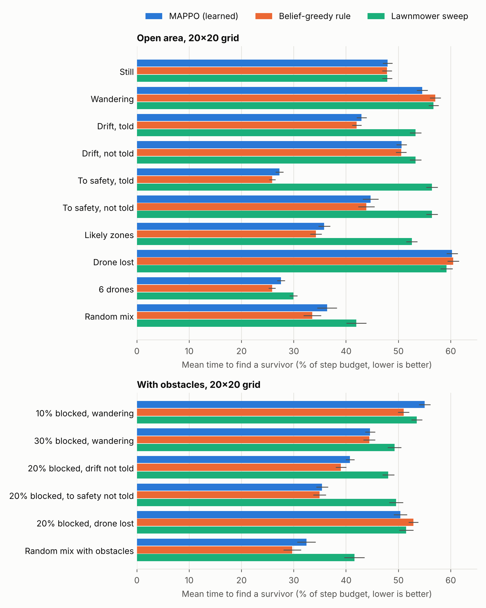
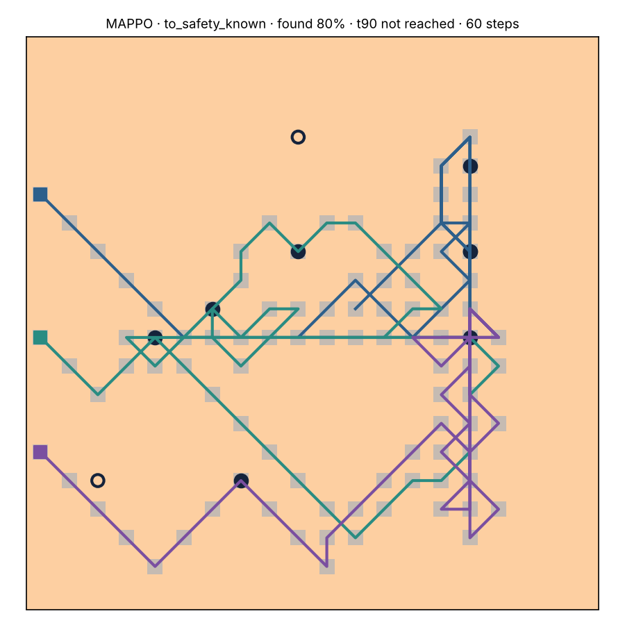
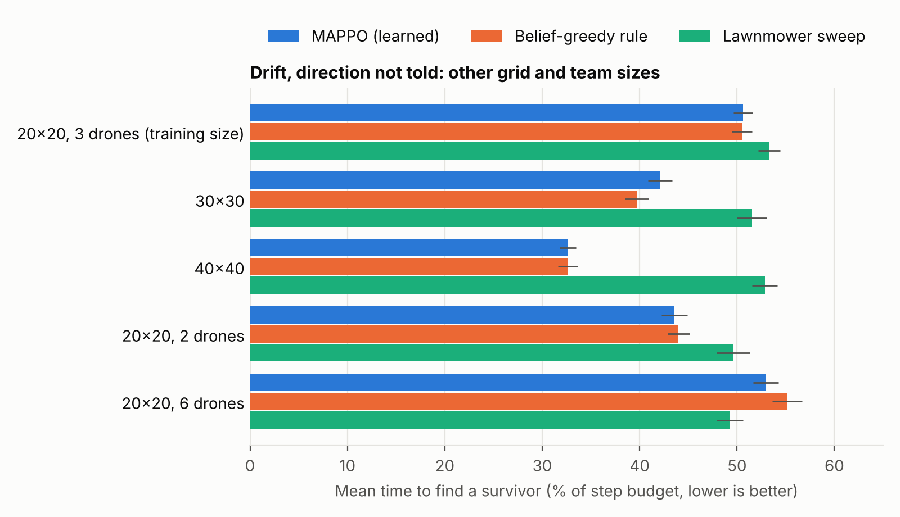
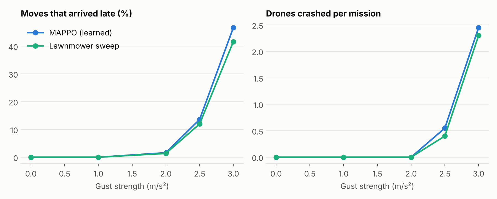

# Cooperative Drone Swarm Search with MAPPO: Results

MSML642 project, Hassan Edwan. This report summarises what was built, what was
measured, and what was learned. Setup and usage are in the [README](../README.md).

## 1. Summary

A team of 2–8 drones searches a disaster area for survivors who may be still,
wandering, drifting (flood water) or walking toward a safe point. The drones
share a probability map of where survivors could be, which they keep up to date
as they search, and one shared policy trained with MAPPO picks every drone's
next move.

Main findings:

1. **The shared probability map is what makes the search fast.** Methods that
   use it find survivors up to twice as fast as a lawnmower sweep when
   survivors move predictably or there are likely zones, 15–25% faster on
   random mixes of scenarios, and 20–40% faster on larger grids. When the
   drones are not told how survivors move, they work it out during the search;
   this beats the sweep but recovers only part of the advantage of being told.
2. **The learned policy is as good as a strong hand-written rule that uses the
   same map**, generalises without retraining to larger grids (30×30, 40×40)
   and other team sizes, and is ahead on the hardest condition tested (40×40,
   destination unknown).
3. **The policy flies.** In PyBullet with Crazyflie dynamics and PID control,
   the 3D missions match the 2D ones exactly in calm air, hold up to gusts of
   about 2 m/s², and fly round buildings with no hits in calm air.
4. **There is a ceiling, and it is information, not learning.** Run-time
   lookahead, imitating the rule then fine-tuning with RL, showing drones all
   teammates' trails and headings, and giving the policy memory all land at the
   same level.
5. **Limitation:** when survivors are still and there is no prior information,
   nothing beats a plain sweep. That case is pure coverage, which a sweep
   already does optimally.

## 2. Problem and environment

| Item | Setting |
|---|---|
| Area | 20×20 grid of 10 m cells (200 m × 200 m); also tested at 30×30 and 40×40 |
| Time | one step ≈ 1 s; 200-step budget for 3 drones on 20×20 (scaled with area and team size elsewhere) |
| Drones | 2–8; may lose one mid-mission; move to one of 8 neighbours or hover |
| Survivors | 1–20; still, wandering, drifting one way, or heading to a safe point, at 0.3–1.5 m/s |
| Prior | 60% of scenarios have no likely zones; the rest have 1–5 zones of 50–100% accuracy |
| Detection | camera finds a survivor in the cell below with probability 0.6–1.0 per pass |
| Obstacles | 0–30% of cells as 1–4-cell blocks; survivors route around them |
| Safety | a shield resolves conflicting moves before they happen, so drones never collide |

**Shared probability map.** The team keeps the expected number of undetected
survivors in each cell. A search scales a cell down by the detection
probability, and each step the map moves the way survivors move. When the
operator does not say how survivors move, the team tracks 116 movement
hypotheses (still; wander or drift in four directions at three speeds; head to
one of 100 safe points) and reweights them after every search, so the map is
the posterior mixture.

**Observation (per drone, 167 values).** 5×5 local windows of the map, of
"searched recently", of obstacles and of teammates; a 5×5 summary of the whole
map; own position, battery and time; the two nearest teammates; the (known or
inferred) movement profile. Nothing depends on grid size, so one policy runs on
any map.

**Reward.** The expected survivors each drone's search detects, +10 to all
drones for each survivor found, and a small step cost.

**Training.** MAPPO: one shared actor, a centralised critic that sees the full
state during training only. 2M environment steps per model (about 2–2.5 h on 4
CPU cores). The M1 model trains on open areas with movement inference; the M2
model is fine-tuned from it with obstacles up to 30%.

## 3. Methods compared

| Method | What it does |
|---|---|
| Lawnmower | Fixed back-and-forth sweep, split between the drones. Ignores the map. |
| Belief-greedy rule | Each drone heads for the cell with the highest map value per unit of travel distance, avoids cells near teammates' targets, and keeps a target until it arrives or the target's value halves. Written for this project as a strong baseline. |
| MAPPO | The learned shared policy (the M2 model unless stated). |

**Metric.** Mean time to find a survivor, with any survivor not found counted
as the whole budget, reported as a share of the budget (lower is better). It
rewards finding survivors early and finding all of them. Time to find 90% of
survivors and the share found are in the full result tables. Each condition
runs 100 episodes (50 on the larger grids), and every method sees the same
missions.

## 4. Results

### 4.1 Search speed on the 20×20 grid



| Condition | MAPPO | Belief-greedy | Lawnmower |
|---|---|---|---|
| Still | 48% | 48% | 48% |
| Wandering | 55% | 57% | 57% |
| Drift, told | 43% | 42% | 53% |
| Drift, not told | 51% | 51% | 53% |
| To safety, told | 27% | 26% | 56% |
| To safety, not told | 45% | 44% | 56% |
| Likely zones | 36% | 34% | 53% |
| Drone lost | 60% | 60% | 59% |
| 6 drones | 28% | 26% | 30% |
| Random mix | 36% | 34% | 42% |
| 20% blocked, drift not told | 41% | 39% | 48% |
| 20% blocked, to safety not told | 35% | 35% | 50% |
| 30% blocked, wandering | 45% | 44% | 49% |
| Random mix with obstacles | 32% | 30% | 42% |

Standard errors are about ±1 percentage point. Full tables:
`results/m5/results_m1a.md`, `results_m1b.md`, `results_m2.md`.

- When survivors move in a predictable way, the map-based methods are far
  ahead: heading to a known safe point, they find survivors in half the
  lawnmower's time.
- Not being told the movement costs a lot: heading to safety, find time rises
  from 27% to 45% of the budget, and drifting, from 43% to 51% (close to the
  sweep's 53%). Inferring it online still matters. Against assuming the
  default movement, adding inference cut the time to find 90% from 183 to 142
  steps for "to safety, not told" and from 189 to 163 for "drift, not told"
  (`results/m1_moving` vs `results/m1_infer`).
- With still or randomly wandering survivors and no likely zones, all three
  methods tie. There is nothing to predict, and a sweep is already the best
  way to cover an area.



*MAPPO on "to safety, told" (first 60 steps). The drones converge on where
survivors are heading instead of sweeping; filled dots are found survivors.
The lawnmower on the same mission: `results/figures/episode_lawnmower.png`.*

### 4.2 Other grid and team sizes



The policy was trained only on 20×20 grids, and the budget here scales with
area per drone. Results are in `results/m5/results_sizes40.md` and
`results_sizes30_teams.md`.

- **Larger grids.** With drift direction unknown, the map-based methods are
  about 20% faster than the sweep on 30×30 and 38% faster on 40×40, against
  4% on 20×20. A bigger area gives more room to be smart about where to look.
- **The hardest condition.** On 40×40 with survivors heading to an unknown
  safe point, MAPPO took 319–336 steps against the rule's 364 and the
  lawnmower's 409. The standard error is about ±25 steps, so this is
  suggestive rather than conclusive.
- **Tight budget.** With 6 drones the budget is only 100 steps, and the sweep
  edges ahead. With so little time per drone, a sweep's lack of overlap
  matters most.

### 4.3 3D flight (M3, M4)

Each policy step is flown by Crazyflie quadrotors in PyBullet (gym-pybullet-drones)
with a PID controller, one altitude layer per drone. A drone that has not
reached its cell centre at the end of the step does not search that step.

- **Calm air.** The 3D missions reproduce the 2D results exactly: tracking
  error is about 1 cm, no move arrives late, and there are no near misses
  (`results/m3/results_pybullet.md`).
- **Buildings (M4).** Buildings are taller than the drones, and diagonal moves
  past a building's corner are forbidden. In calm air there were no building
  hits, and MAPPO stayed ahead of the sweep on all four conditions
  (`results/m4/results_pybullet_m4.md`).
- **Wind.** Up to 2 m/s² of gusts, fewer than 2% of moves arrive late and no
  drone crashes. At 2.5 m/s² about 13% of moves arrive late and some drones
  crash, and at 3 m/s² flight breaks down. Both methods behave the same,
  because the limit is the controller, not the search
  (`results/m3/results_pybullet_windsweep.md`). With buildings and 2 m/s²
  gusts, drones near walls get hit and some crash
  (`results/m4/results_pybullet_m4_wind2.md`).
- The 3D runs use 10–20 episodes each, so their percentages are coarse.



### 4.4 Trying to beat the rule

The learned policy matches the hand-written rule but does not beat it. Four
ideas were tested to push it further, each aimed at one possible cause.

| Idea | Hypothesis | Result |
|---|---|---|
| Run-time lookahead (re-rank the policy's top 3 moves by the best 3-step path on the map) and sharper action choice | The policy is close but noisy | 0–7 steps better; within noise on most conditions |
| Imitate the rule, then fine-tune with RL (BC + 3 DAgger rounds, then 2M PPO steps with a fading KL anchor) | RL started from scratch lands in a worse optimum | RL improved the copy by 5–11 steps, to the same level as MAPPO from scratch; not past the rule |
| Team layers: every teammate's position, a trail fading over ~20 steps, and projected heading, drawn on maps | Drones lack the teammate information the rule uses | No change: the copy matched the rule's moves 52–59% of the time with or without them |
| Memory (GRU actor) | The rule keeps a target across steps, which a memoryless policy cannot | Small gain: matches the rule 2–3 points more often in later rounds; solo find time 28% vs 29% (rule: 27%) |

Logs: `models/bc_*_imitate.log`; RL results: `results/m5/results_imit_*.md`.

**Reading.** Every route converges to the same level. The copies disagree with
the rule on about 45% of moves yet perform almost the same, so most decisions
are between near-equal options. Team awareness adds nothing because the shared
map already shows where everyone has searched. Memory helps a little because it
lets a drone stick to a plan. The bottleneck is what the drones can know, not
how the policy is trained.

## 5. Limitations

- **Coverage problems.** Still survivors with no prior: no method beats a
  sweep (§4.1).
- **Communication.** The map is assumed to be shared perfectly and instantly
  between all drones. Real radios have limited range and bandwidth.
- **Sensing.** The camera sees only the cell directly below, with a fixed
  detection probability, and nothing blocks its view.
- **Flight.** 3D flight uses a PID controller tuned for calm-to-moderate wind,
  and the 3D results come from small samples.
- **Compute.** All training ran on 4 CPU cores, so each model got 2M steps and
  a single seed; seed-to-seed variation is not measured.

## 6. Future work

- **Limited communication** (most promising). Drones share maps only within
  range, or every few steps. The rule depends on a shared map, so this is
  where learned coordination could beat it.
- **Battery and return-to-base**, so missions involve planning recharges.
- **Camera with occlusion**: buildings and trees block the view, as in the
  original M5 stretch goal.
- **An RL flight controller** to replace PID, for stronger wind.
- **Recurrent PPO** with the GRU actor, if the problem changes enough that
  memory matters.

## 7. Reproducing

```bash
pip install -r requirements.txt && python -m pytest          # 46 tests
python scripts/train.py --algo mappo --steps 2000000 --out runs/m1
python scripts/train.py --algo mappo --obstacles 0.3 --init runs/m1/model.pt --out runs/m2
python scripts/evaluate.py --models models/m2_2m.pt --m5 --episodes 100 --out results/m5
python scripts/run3d.py --model models/m2_2m.pt --backend pybullet --episodes 20   # needs requirements-3d.txt
python scripts/imitate.py --obstacles 0.3 --out models/bc_greedy.pt               # imitation (§4.4)
python scripts/make_figures.py                                                    # figures in results/figures/
```
