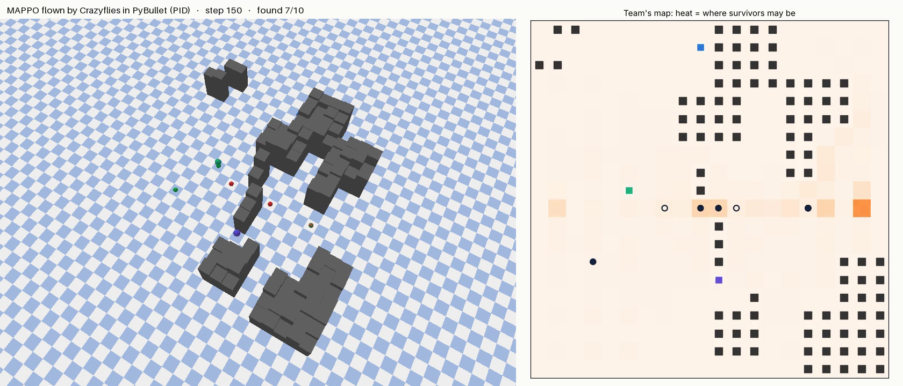

# Cooperative Drone Swarm Search with Multi-Agent Reinforcement Learning

*Phase 1 Progress Report*

Hassan Edwan · MSML642 · November 2026

**Summary.** Phase 1 set out to show that one shared policy, trained with
multi-agent reinforcement learning, can coordinate a drone swarm to find 90%
of survivors faster than a fixed lawnmower sweep, first in 2D and then in 3D
flight. Both objectives are met: where survivors move or likely zones exist,
the swarm reaches 90% up to twice as fast and in far more missions, and the
missions fly in a physics simulator. Realistic sensing and limited
communication, planned as later work, were also built, and the simulator was
extended into a field environment grounded in search-and-rescue data in
preparation for large-scale training in Phase 2.

## 1. Objectives

The proposal described a swarm of 2–8 drones searching a disaster area for
survivors under one shared policy trained with MAPPO. The policy should adapt
to each scenario: use likely zones when they exist, split the area when they
do not, re-check where survivors may have moved, and cover for a lost drone.
The measure of success is the time to find 90% of survivors, compared with a
fixed lawnmower sweep. The plan was to show this in a 2D grid world, add
obstacles, fly the missions in 3D with buildings, and then move towards
realistic sensing, limited communication and learned flight control.

*Table 1. Progress against the proposal.*

| Objective | Status | Evidence |
|---|---|---|
| Shared MAPPO policy for 2–8 drones | Achieved | One actor for all drones, any map or team size |
| Find 90% faster than a sweep | Achieved | Where survivors move or zones exist (Table 2) |
| Use likely zones | Achieved | 155 vs 185 steps to 90% |
| Re-check where survivors moved | Achieved | Movement inferred during the search |
| Split the area with no prior | Equal to sweep | Pure coverage, where a sweep is optimal |
| Cover for a lost drone | Equal to sweep | 197 vs 194 steps |
| 2D grid with obstacles | Achieved | Table 2, Figure 1 |
| 3D flight with buildings | Achieved | Figure 2 |
| Realistic sensing | Achieved early | Figure 3 |
| Limited communication | Achieved early | Figure 4 |
| Learned flight control | Phase 2 | Search outputs waypoints for any controller |

## 2. Search Performance

The drones share a probability map of where survivors may be, lowered wherever
they search and shifted each step the way survivors move; when nobody says how
survivors move, the team works it out from what it finds. Table 2 compares the
learned policy with the lawnmower on 100 missions per condition. When
survivors move or the team has likely zones, the swarm reaches 90% up to about
twice as fast and in far more missions. With still survivors and no prior the
task is pure coverage, and the two tie.

*Table 2. Steps to find 90% of survivors (of 200; lower is better) and share
of missions reaching 90%.*

| Condition | MAPPO | Lawnmower |
|---|---|---|
| Walking to a safe point, told | 98 (99%) | 186 (35%) |
| Walking to a safe point, not told | 148 (70%) | 186 (35%) |
| Drifting, told | 156 (79%) | 183 (41%) |
| Likely zones | 155 (56%) | 185 (34%) |
| Obstacles, walking to safety, not told | 125 (82%) | 169 (62%) |
| Random mix of scenarios | 140 (64%) | 151 (57%) |
| Still survivors, no prior | 170 (60%) | 167 (58%) |
| A drone is lost | 197 (6%) | 194 (10%) |

*Figure 1. The 2D grid with obstacles: one mission flown by eight methods
([video](../results/figures/all_models.mp4)). Survivors walk to a safe point
the drones are not told about; the map-based methods converge on it.*

## 3. Flight in Three Dimensions

Each step of the policy was flown by quadrotors in the PyBullet physics
simulator under PID control, among buildings taller than the drones. In calm
air the 3D missions reproduce the 2D results, and they hold up to gusts of
about 2 m/s². Because the search layer only chooses the next cell, a learned
flight controller can later replace PID without changing it.

*Figure 2. A mission flown by Crazyflie quadrotors in PyBullet beside the
team's map ([video](../results/figures/flight_3d.mp4)).*

## 4. Beyond the Plan

A hand-written rule that uses the same map does as well as the learned
policy, and further learning methods (imitation, lookahead, teammate
information, memory) reached the same level. To understand why, the
simulation was made more realistic. A camera model added flying height, sight
lines past buildings, cover and false alarms that must be confirmed from low
altitude (Figure 3); it also showed that the training reward must match the
goal, since early policies hovered high and found nobody until finds were
rewarded for being early. Reinforcement learning on top of a copy of the rule
improved it at first, but drifted away from it once the pull towards the copy
was released; the camera runs ended below the rule.

Next, the world was allowed to disagree with the drones' model: a sensor
weaker than assumed, buildings that had collapsed unseen, radio links that
share maps only within range, and wind and positioning error. Under these
conditions the rule trusts a map that is wrong and falls below a plain sweep
(Figure 4). This is the setting in which a learned policy that adapts to
evidence has room to improve on hand-written strategies.

*Figure 3. Realistic sensing: flying height, footprints and confirmation of
detections ([video](../results/figures/camera_models.mp4)).*
*Figure 4. The world disagrees with the drones' model; the rule loses its
advantage over the sweep ([video](../results/figures/real_gaps.mp4)).*

## 5. Preparation for Phase 2

To give Phase 2 a realistic target, the simulator was extended into a field
environment built from search-and-rescue research, with every assumption
recorded alongside its source ([ASSUMPTIONS.md](ASSUMPTIONS.md)). It covers
urban collapse, wilderness and flood scenarios on real or generated terrain.
Lost-person statistics set where people go and how large the search area is;
people may not respond to drones or may hide; an operator must confirm each
detection; drones swap batteries and lose radio contact behind terrain; and
ground teams carry out the rescue. Realistic wilderness search is hard, mostly because many lost people have
walked beyond any area that can be searched in 90 minutes (Table 3).

A first learned policy was trained here on four CPU cores: a copy of the rule,
refined by 4 million steps of reinforcement learning with the pull towards the
copy kept on. It matches the rule in the wilderness, where both beat the sweep,
does better when radio links fail, and is slightly behind on the unseen flood
scenario. It does not yet improve on the rule overall, which is the target for
Phase 2.

*Table 3. Field environment, 50 missions per condition: share of missions in
which the person is found (in brackets: among people inside the search area).*

| Scenario | Lawnmower | Rule | Learned |
|---|---|---|---|
| Wilderness, nine conditions pooled | 19% (61%) | 24% (66%) | 25% (67%) |
| Wilderness, radio links fail | 15% (57%) | 16% (58%) | 26% (68%) |
| Urban collapse | 75% (81%) | 77% (83%) | 74% (80%) |
| Flood, not seen in training | 56% (68%) | 53% (65%) | 48% (58%) |

Phase 2 will train in this environment at scale: imitation of the rule
followed by reinforcement learning with the find-time reward, across scenario
families, with several seeds and many more missions per update, evaluated on
hard cases and on the unseen flood scenario. This requires more compute than the four CPU cores used in Phase 1,
and will be followed by calibration against field tests and a learned flight
controller.

*Figure 5. The field environment: (a) wilderness, a hiker on an 11.6 km map
sized from lost-person data ([video](../results/figures/field_wilderness.mp4));
(b) urban collapse with smoke ([video](../results/figures/field_urban.mp4));
(c) flood, held out for testing ([video](../results/figures/field_flood.mp4)).
The same wilderness mission flown by the sweep
([video](../results/figures/field_base_sweep.mp4)) and the learned policy
([video](../results/figures/field_learned.mp4)), and seen from one drone's
cameras ([video](../results/figures/field_drone_view.mp4)).*
