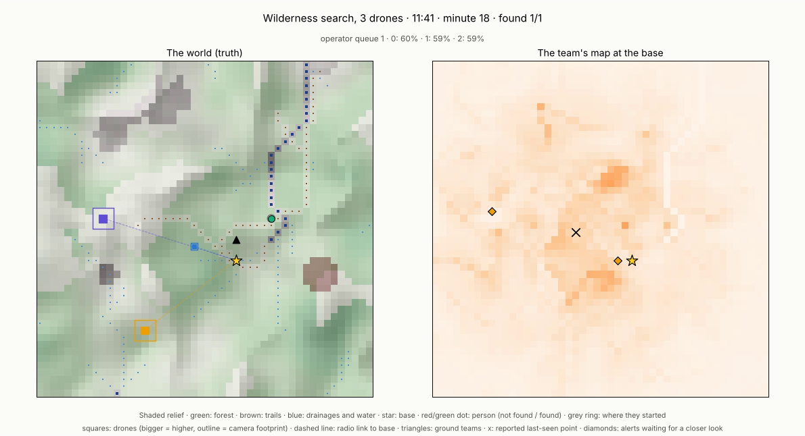

# Drone Swarm Search: Phase 1 Progress Report

Hassan Edwan · MSML642 · November 2026

## Goal

The project proposed a drone swarm that searches a disaster area for
survivors under one shared policy trained with multi-agent reinforcement
learning (MAPPO). The policy should adapt to each scenario (use likely zones
when they exist, split the area when they do not, re-check where survivors
may have moved, cover for a lost drone) and **find 90% of survivors faster
than a fixed lawnmower sweep**. The plan was to show this in a 2D grid world,
add obstacles, then fly it in 3D, and later move towards realistic sensing,
limited communication and learned flight control.

This report checks phase 1 against that plan.

## Where we stand

| Proposal item | Status | Evidence |
|---|---|---|
| Shared MAPPO policy for 2–8 drones | Done | One actor for every drone; works on any map and team size |
| Find 90% of survivors faster than a sweep | Met where survivors move or likely zones exist; tie otherwise | Table 1 |
| Use likely zones | Done | 155 vs 185 steps to 90% |
| Re-check where survivors may have moved | Done | The team infers how survivors move during the search |
| Split the area when there is no prior | Matches the sweep | Pure coverage; nothing beats a sweep here |
| Cover for a lost drone | Matches the sweep, no better | 197 vs 194 steps |
| M1 2D grid, M2 obstacles | Done | Table 1, Figure 1 |
| M3–M4 3D flight with buildings | Done | Matches 2D in calm air; holds up to ~2 m/s² gusts (Figure 2) |
| Future: realistic sensing | Done ahead of plan | Camera with flying height, line of sight, cover, false alarms (Figure 3) |
| Future: limited communication | Done ahead of plan | Radio groups that share maps only in range (Figure 4) |
| Future: learned flight controller | Phase 2 | The search layer gives waypoints, so a controller can replace PID later |

**Table 1.** Time to find 90% of survivors (steps of 200; lower is better) and
share of missions that reach 90%; 100 missions each.

| Condition | MAPPO | Lawnmower |
|---|---|---|
| Walking to a safe point (told) | **98** (99%) | 186 (35%) |
| Walking to a safe point (not told) | **148** (70%) | 186 (35%) |
| Drifting (told) | **156** (79%) | 183 (41%) |
| Likely zones | **155** (56%) | 185 (34%) |
| Obstacles, walking to safety (not told) | **125** (82%) | 169 (62%) |
| Random mix of scenarios | **140** (64%) | 151 (57%) |
| Still survivors, no prior | 170 (60%) | 167 (58%) |
| A drone is lost | 197 (6%) | 194 (10%) |

When survivors move or the team has likely zones, MAPPO reaches 90% up to
about twice as fast and in far more missions. With still survivors and no
prior, the task is pure coverage and both tie.

## What else phase 1 showed

- **The shared map does most of the work.** A hand-written rule using the same
  map does as well as MAPPO; learning matched it but did not beat it, even
  with imitation, lookahead, teammate information or memory.
- **That ceiling comes from the simulator being too kind to the rule.** When
  the world stops matching the rule's model (a weaker sensor than assumed,
  collapses nobody mapped, radio limits), the rule falls below a plain sweep
  (Figure 4). A policy that adapts to evidence has room to win there.
- **Rewards must match the goal.** With a camera, RL first hovered high and
  found nobody; the fix was a reward that pays more for earlier finds.

## Getting ready for phase 2

To make phase 2 meaningful, the simulator was extended into a **field
environment** built from search-and-rescue research: real terrain (or a real
site's map data), lost-person statistics (ISRID) setting where people go and
how large the area is, people who do not respond or hide, an operator who
reviews every detection, batteries and swaps, radio blocked by terrain, and
ground teams. It covers urban collapse, wilderness and flood scenarios
(Figure 5). Realistic wilderness search is hard: the baselines find the person
in about a quarter of sample missions, which leaves clear room for a better
policy. Every modelling choice and its source is listed in
[ASSUMPTIONS.md](ASSUMPTIONS.md).

**Phase 2** is training at scale in that environment (imitation of the rule,
then RL with the find-time reward, several seeds, across scenario families,
tested on unseen flood missions and hard cases), which needs more compute than
the 4 CPU cores used so far, followed by field calibration and a learned
flight controller.

## Figures

**Figure 1.** 2D grid with obstacles, eight methods on one mission.
[Video](../results/figures/all_models.mp4)

**Figure 2.** The same kind of mission flown in 3D (PyBullet).
[Video](../results/figures/flight_3d.mp4)

**Figure 3.** Camera with flying height and confirmation of detections.
[Video](../results/figures/camera_models.mp4)

**Figure 4.** Sweep and rule when the world disagrees with the drones' model.
[Video](../results/figures/real_gaps.mp4)

**Figure 5.** Field environment: wilderness, urban collapse, flood.
[Wilderness](../results/figures/field_wilderness.mp4) ·
[Urban](../results/figures/field_urban.mp4) ·
[Flood](../results/figures/field_flood.mp4)

